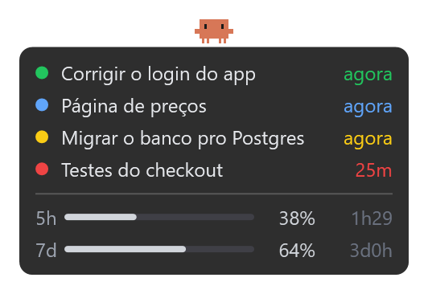
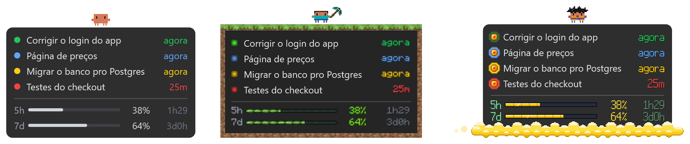

# Claude Monitor

[Português](README.md)

A small floating window that always stays on top, in the corner of your screen,
showing your Claude Code sessions and how much of your limit you have used. You
can leave 3 or 4 sessions running and go do something else: when one finishes
or needs you, it lets you know with a sound.



**[⬇️ Download ClaudeMonitor.zip](https://github.com/LucasM-Maciel/ticlins-claude-monitor/releases/latest/download/ClaudeMonitor.zip)** (Windows, Mac and Linux in the same file)

> A personal, unofficial project, not affiliated with Anthropic (Claude),
> Mojang (Minecraft) or the owners of Dragon Ball, Naruto, Star Wars (Lucasfilm)
> and Elden Ring.

## What it shows

| Dot | Meaning |
|---|---|
| 🟢 green, pulsing | working |
| 🔴 red | done |
| 🔵 blue | asking you a question |
| 🟡 yellow | needs permission to run something |

- **The time on the right**: how long the session has been in this state.
- **5h and 7d**: the same as Claude Code's `/usage` (the 5-hour limit and the
  weekly one), with the time left until it resets. It turns orange at 80% and
  red at 95%.
- **The pace**: the white tick on the bar marks where your usage would be if
  you spent it evenly until the reset (it is how much of the time has already
  passed). The number beside it is your usage minus that: **+12** in orange =
  12 points above the pace (you will run out before the reset), **-30** in
  green = plenty to spare.
- **Clawd** (the little orange critter): walks around the card when any session
  is running, jumps when someone is waiting for you, and stays still when
  everything is quiet. While walking, now and then it stops and does something,
  depending on the [theme](#themes).
- **Sound**: when a session finishes or needs you, plus a special sound when the
  last one finishes (all done). Each theme has its own.
- **Inside VS Code**: a "Claude Monitor" tab in the sidebar with the sessions
  (click one to go straight to it) and a counter in the status bar.

## How to install

You need:

- **Claude Code**, logged in with your Claude account (Pro/Max). Usage does not
  show up if you use an API key.
- **VS Code** (or Cursor).
- **Node.js**, LTS version: [nodejs.org](https://nodejs.org). Claude Code uses
  it to notify the floating window.

### Windows

1. [Download ClaudeMonitor.zip](https://github.com/LucasM-Maciel/ticlins-claude-monitor/releases/latest/download/ClaudeMonitor.zip).
2. Right-click the file > **Extract All**.
3. Inside the extracted folder, double-click **`instalar-windows.cmd`**.
   If "Windows protected your PC" appears, click
   **More info > Run anyway**.
4. Close and reopen VS Code.

### Mac

1. [Download ClaudeMonitor.zip](https://github.com/LucasM-Maciel/ticlins-claude-monitor/releases/latest/download/ClaudeMonitor.zip)
   and double-click it (the Mac extracts it by itself).
2. Open **Terminal** (`Cmd + Space`, type *Terminal*, Enter).
3. Type `bash ` (with a space at the end), **drag the file
   `instalar-mac.sh`** into the Terminal window and press Enter.
4. Close and reopen VS Code.

The first time, the Mac may ask you to install the **command line tools**.
Click Install, wait for it to finish (a few minutes) and repeat step 3.

If the Mac asks whether **"security" can access "Claude Code-credentials"**,
click **Always Allow**. It is just the floating window reading your usage.

### Linux

1. [Download ClaudeMonitor.zip](https://github.com/LucasM-Maciel/ticlins-claude-monitor/releases/latest/download/ClaudeMonitor.zip)
   and extract it.
2. Open a terminal inside the extracted folder and run `bash instalar-linux.sh`.
3. Close and reopen VS Code.

The floating window uses Python + GTK 3 (already included in Ubuntu with GNOME).
If the cairo bridge (`python3-gi-cairo`) is missing, the installer downloads it
without needing root; if anything else is missing, it tells you the right
`apt install`. It works on Xorg and Wayland (through XWayland). Without the
engine (no Node), you only get the card, without Clawd.

**VS Code connected to WSL** (Windows): the floating window opens on Windows and
shows the WSL sessions together with the Windows ones. Claude Code running in a
WSL terminal while VS Code is open on Windows (not connected to WSL) does not
show up yet.

Done: the floating window appears in the bottom-right corner. Claude sessions
that were already open need to be reopened to show up; new ones show up by
themselves.

**To update**: when a new version comes out, VS Code shows "Claude Monitor X is
available" with a **Download** button, and the floating window gets a purple line
"↑ version X available · download" (click it). Download, extract and follow the
`HOW TO UPDATE.txt` that comes in the zip (it is just installing again over the
old one). Afterwards VS Code shows "Claude Monitor updated" with a **Reload**
button: click it when no Claude is working in that window.

## How to use

- **Open a session**: click it and VS Code opens its tab (or terminal). The
  first time, VS Code asks whether to let the extension open the link: check the
  box so it does not ask again. It works with VS Code (not with Cursor).
- **Move**: click and drag.
- **Go to VS Code**: double-click the floating window.
- **Preferences**: right-click the floating window to change the **Theme** (◀ ▶),
  turn **Clawd** on or off, and change the **Opacity** and the **Volume** of the
  sounds. They are saved for next time.
- **Usage** (right-click, ◀ ▶): which usage bars show up: the **Claude** ones
  (the default), the **Codex** ones or **Both**.
- **Language**: right-click the floating window > "Idioma" (it
  reads "Language" once switched) > pick **English** (the default is
  Portuguese).
- **Close**: right-click > Close.
- **Reopen**: in VS Code, `Ctrl+Shift+P` (Mac: `Cmd+Shift+P`) >
  **Claude Monitor: Abrir janelinha flutuante** (opens the floating window).
  On Windows there is also a "Claude Monitor" shortcut on the Desktop.
- **Turn the floating window off** and keep only the sidebar: in VS Code
  settings, uncheck **Claude Monitor: Overlay**.

## Codex

If you also use Codex (OpenAI) in VS Code or in the terminal, its sessions show
up in the same list, with a small **codex** tag next to the name. Nothing to
install: the extension reads the `~/.codex` folder (only what it records about
sessions and usage limits; never the login) and counts a session as open if it
did anything in the last 6 hours. Did it end by asking something? It shows up as
a question, just like Claude. Clicking a Codex session opens its sidebar in VS
Code.

To see the Codex usage bars (the 5h, 7d or 30d windows, depending on your plan),
change **Usage** in the right-click menu.

## Themes



Right-click > **Themes ◀ ▶**. A fresh install starts on Default; if you were
already using the floating window before themes existed, you stay on Minecraft.

- **Default**: Clawd with no gear. It stomps on a bug, opens a laptop, drinks
  coffee, thinks, ticks off the to-do list and throws a party when everything
  is done. When everything is quiet, it sleeps (with a snot bubble and
  programmer dreams) or plays video games on a CRT TV, winning or losing (once
  each). Every 15 bugs stomped brings a special event, with sound:
  **Space Invaders** and **Bug Kaiju**, one at a time. The alerts are a bell.
- **Minecraft**: Clawd as Steve (sometimes as Alex; very rarely, as Herobrine),
  a dirt border with grass, XP orbs for dots, and usage on the XP bar. While
  walking, it fights zombies, skeletons, creepers, spiders and other mobs, or
  mines; it levels up every 5 kills and, every 20, fights the **Ender Dragon**,
  with the game's sounds. When everything is quiet, it puts down a bed and
  sleeps, or digs a little pond and fishes (once each).
- **Dragon Ball**: Clawd in a gi, who sometimes transforms; the flying cloud,
  the dragon balls in place of the dots, and the ki bar ("OVER 9000!").
  Each session that finishes gives one ball; on the 7th, the dragon appears and
  grants a wish for Clawd (infinite limit, magic beans, a banquet or bug-free
  code, one at a time). Every 400 laps around the card comes the **full moon**:
  it turns into a giant golden ape and comes back as Super Saiyan 4, which lasts
  2 min. When everything is quiet, it meditates floating or trains (once each).
- **Star Wars** (made by [gjthec](https://github.com/gjthec)): Clawd in black
  armor, with a cape and a red lightsaber; a neon frame, kyber crystals in place
  of the dots, and usage on lightsabers that change color as you spend
  (violet, purple, magenta, red). While walking, it deflects blaster bolts,
  cuts a droid in half, lifts another with the Force or just takes a deep
  breath; when everything is quiet, it meditates levitating rocks or assembles a
  lightsaber in the air (once each); when everything is done, it jumps into
  hyperspace. Every 50 laps around the card it **switches sides of the Force**:
  on the light side it wears the robe, the saber turns green and the card goes
  off-white, green and brown; 50 more laps and it goes back to the dark side.
  Every 30 droids destroyed brings a special event, with sound, one for each
  side: **The Battle of the Fleet** (in space) and **The Defense of the
  Forest**. The alerts are droid beeps and the saber igniting.
- **Akatsuki** (Naruto): the ninja Clawd in a black cloak with red clouds; the
  clouds run along the card's border leaving a trail, little clouds in place of
  the dots, and usage on a bar with a kunai at the tip. While walking, it
  releases smoke clones, turns into a flock of crows, swaps places with a log or
  spits a fireball, against a bug, an ANBU, a Leaf ninja or Kakashi; when
  everything is quiet, it eats ramen or trains throwing kunai (once each); when
  everything is done, the red moon rises behind the card. Every 50 laps around
  the card it **switches sides**: it becomes **Team 7**, with a navy-blue and
  orange card and leaves in place of the clouds, and fights with Gamabunta and
  the Rasenshuriken, the Rasengan, the Chidori and a river of leaves, against
  White Zetsu, a rogue ninja or a puppet. Each side has 3 outfits, one per
  switch (on the Akatsuki side, one of them is the orange spiral mask). Every
  30 enemies defeated brings a special event, with sound, one for each side: the
  **ten-tailed beast** and **the full Team 7** (Susanoo, Kurama and Sakura's
  punch). The alerts are clinking kunai and a plucked string, all made from
  scratch.
- **Elden Ring**: the Tarnished Clawd as a knight, a bandit or a sorcerer, with
  a new outfit every lap. A gold frame with diamonds and a Golden Tree flourish,
  diamond-shaped dots and gold usage (amber at 80%, red at 95%). While walking,
  it fells enemies and gathers runes, reads a message, opens a mimic chest or
  sees **YOU DIED** and returns in the golden light. When everything is done, it
  discovers a site of grace; when everything is quiet, it rests at the grace or
  pets Torrent (once each). Every 30 enemies felled brings a boss fight, with
  sound: **Margit, Godrick, Malenia and Radahn**, one at a time. The alerts are
  a golden bell, a grace chord and a gong with harp, all made from scratch.

The animations need Node.js (which the installer already asks for); without it
the floating window shows the plain Clawd, without the scenes.

### Minecraft sounds and textures

In the Minecraft theme the sounds are the **game's**: the villager's "hmm" when
someone is waiting for you, the XP sound when a session finishes, and the
**level-up** sound when the last one finishes (nothing else running or waiting
for you). The mobs, the blocks and the dragon are also the game's.

The installer downloads everything from Mojang's server, the same one the game
launcher uses: **you do not need to own Minecraft or have ffmpeg**, and nothing
from Mojang ships in the package. Installed without internet? The extension
downloads it by itself later, or, in VS Code:
`Ctrl+Shift+P` > **Claude Monitor: Usar sons do Minecraft** (uses the Minecraft
sounds).

## Having trouble?

**No sessions show up.** Reopen your Claude sessions (the floating window only
sees the ones opened after the installation). If it continues, check that
Node.js is installed: open a terminal and run `node -v`. Without `node` in the
PATH, the monitor uses VS Code's own.

**"usage unavailable".** It only shows up if it has never managed to read the
usage (after the first time, it shows the last one it saw). Wait 2 minutes, it
tries again. If it does not come back, check that Claude Code is logged in with
your Claude account (`/login`), and not with an API key.

**The floating window disappeared.** `Ctrl+Shift+P` > **Claude Monitor: Abrir
janelinha flutuante** (opens the floating window). If it disappeared by itself
(after an update, for example), send the `janelinha.log` file from the
`.claude-monitor` folder (inside your user folder) to whoever gave you Claude
Monitor.

**The dot is wrong** (yellow without asking for anything, for example). Take a
screenshot and send it to whoever gave you Claude Monitor.

## What it accesses

Everything stays on your computer. The floating window reads the files Claude
Code already writes (`~/.claude`) and uses your own login to ask for the usage
from the same address `/usage` uses (`api.anthropic.com`). It never renews or
sends your login anywhere else.

If you use Codex, the extension also reads the `~/.codex` folder (only the
sessions and usage limits, never the login) and writes the summary to
`~/.claude-monitor`.

The installation:

- adds 4 hooks to `~/.claude/settings.json` (it keeps a copy of the previous one
  in `settings.json.bak-claude-monitor`);
- creates the `~/.claude-monitor` folder.

## Uninstall

1. In VS Code, uninstall the **Claude Monitor** extension.
2. Delete the `~/.claude-monitor` folder (Windows: `C:\Users\<you>\.claude-monitor`).
3. In `~/.claude/settings.json`, delete the hooks that mention `.claude-monitor`.

## For those who want to hack on the code

```bash
npm ci
npm run empacotar   # builds dist/ClaudeMonitor.zip and the .vsix
npm run testar      # extension tests (Node)
powershell -ExecutionPolicy Bypass -File testes/windows/testes.ps1   # Windows
bash testes/mac/testes.sh                                            # Mac
```

- `extensao/`: the VS Code extension, with the floating window in
  `extensao/janelinha/` (Windows: `overlay.ps1`; Mac: `overlay.swift`) and the
  theme animations in `extensao/janelinha/motor/` (a Node program, the same on
  both: [docs/MOTOR.md](docs/MOTOR.md)).
- `instalar/`: the installers.
- `testes/cenarios.js`: the situations the floating window has to get right on
  both systems.

On every push, GitHub tests the package on a real Mac and a real Windows. A
`v*` tag publishes the .zip on the download page.

PRs are welcome: the Volume, the Opacity and the Clawd on/off switch in the
right-click menu came from the first one, by [@TiagoPortilho](https://github.com/TiagoPortilho) (#1).

## License

[MIT](LICENSE): you can use, copy and change it freely, with no warranty at all
(use at your own risk). Left out are `extensao/janelinha/vorbis.min.js`, with
its licenses in `vorbis-licencas.txt`, and the Minecraft sounds and textures,
which belong to Mojang and are not in the repository. Claude is a trademark of
Anthropic.
